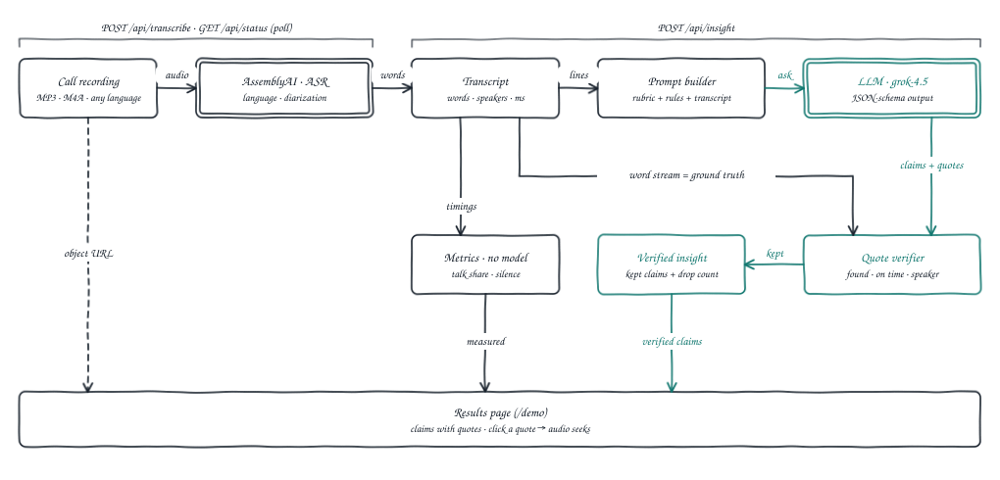

# Architecture

This guide walks through the pipeline stage by stage, with pointers into the
code. It is written for someone who wants to understand how a voice-to-insight
system fits together, or who wants to adapt this one to a different domain.

The worked example is **call-centre quality review**: a recorded support call
goes in, and a short assessment comes out — what went well, what to coach —
where every observation carries a verbatim quote from the call.

A second, smaller pipeline lives alongside it: a **live multilingual (Hindi / French ↔ English) voice
interpreter** at `/interpreter`, written as a deliberately different shape
(short batch requests, no verification, no persistence) so the two examples
together cover both ends of the voice-pipeline design space. See
[section 7](#7-a-second-pipeline--the-live-interpreter).

---

## 1. The shape of it



The diagrams for every flow, state and module are in [DESIGN.md](DESIGN.md).

```
                ┌─────────────── browser ───────────────┐
                │  file input → object URL (playback)   │
                └──────┬───────────────┬────────────┬───┘
                       │ ①             │ ②          │ ③
          POST /api/transcribe   GET /api/status  POST /api/insight
                       │               │            │
                       ▼               ▼            ▼
                ┌─────────────┐  ┌──────────┐  ┌───────────────────────────┐
                │ ASR upload  │  │ ASR job  │  │ fetch transcript          │
                │ + submit    │  │ status   │  │   → metrics (no model)    │
                └─────────────┘  └──────────┘  │   → LLM (structured JSON) │
                                               │   → verify every quote    │
                                               └───────────────────────────┘
```

| Step | Route | What happens | Typical time |
|---|---|---|---|
| ① | `POST /api/transcribe` | Audio bytes are relayed to the ASR provider; a job id comes back | ~2 s |
| ② | `GET /api/status?id=` | The browser polls every 3 s until the job is done | 30–60 s |
| ③ | `POST /api/insight` | Transcript is fetched, measured, analysed and verified | ~20 s |

Times and costs were measured on real 10-minute calls: about 50 s end to end
and about US$0.05 in API usage (~$0.03 transcription, ~$0.02 analysis).

### Why there is no database, storage bucket or webhook

These were left out on purpose, so the project runs with two API keys and
nothing else:

- **No storage.** Audio is relayed through the API route to the ASR provider's
  own upload endpoint. For playback, the browser uses
  `URL.createObjectURL(file)` on the file it already has.
- **No database.** The browser keeps the job id between polls. The server is
  stateless, and results live only in the browser tab.
- **No webhook.** Polling means no public callback URL, no shared secret and no
  tunnel during local development. Each request stays short.

The trade-offs are listed in [section 7](#7-known-limits).

---

## 2. Stage one — speech to text

**Files:** `src/lib/providers/asr.ts` (interface),
`src/lib/providers/asr-assemblyai.ts` (implementation)

The pipeline depends on a small interface, not on a vendor:

```ts
interface AsrProvider {
  upload(audio, contentType): Promise<string>;      // returns a URL the provider can read
  submit(audioUrl): Promise<{ providerId: string }>;
  status(providerId): Promise<TranscriptStatus>;     // "working" | "ready" | "failed"
  fetchResult(providerId): Promise<TranscriptResult>;
}
```

`TranscriptResult` is normalised to the shape the rest of the pipeline needs:
**words** (text, start/end in ms, confidence, speaker label), **utterances**
(speaker turns), detected **language**, **duration** and provider
**sentiment** segments.

The AssemblyAI implementation turns on three features:

- `language_detection` — nobody declares the language up front.
- `speaker_labels` — diarization returns `A` / `B`. These are labels, not roles.
- `sentiment_analysis` — shown as the provider's own three-state label, and
  never converted into a made-up score.

**Speaker roles are a heuristic.** `guessAgentSpeaker()` in
`src/lib/metrics.ts` assumes whoever speaks first is the agent, which is
usually true on inbound support calls. The UI states the assumption next to the
call timeline. Stereo recordings, with each side of the call on its own channel,
remove the guess. (A one-click "swap speakers" control would be a good first
contribution.)

---

## 3. Stage two — measure without a model

**File:** `src/lib/metrics.ts`

Talk share, silence, overtalk, longest agent monologue, speaking rate and time
to first response are computed from the word timings with plain arithmetic. No model is involved, so the same audio
always gives the same numbers.

The UI labels these as **measured**, and keeps them separate from the model's
**judged** output. A reader should always be able to tell a fact from an
opinion.

---

## 4. Stage three — LLM inference with structured output

**Files:** `src/lib/quality-guide.ts`, `src/lib/analysis/prompt.ts`,
`src/lib/analysis/schema.ts`, `src/lib/analysis/run.ts`,
`src/lib/providers/llm.ts`

### The rubric is data

`src/lib/quality-guide.ts` holds one list of categories (opening, discovery,
empathy, politeness register, ownership, …). That single list drives:

1. the category text the model reads in the prompt,
2. the allowed keys in the output schema, and
3. the bar chart in the UI.

**To repurpose the pipeline, this is the first file to change.**

### The prompt

`SYSTEM_PROMPT` sets the rules that make the output checkable:

- Quote the transcript **verbatim**, in the original language and script.
- Copy timestamps from the utterance the quote came from — don't estimate.
- Return `null` for a category the call gave no chance to judge, instead of
  guessing a low score.
- Say less rather than pad.

The transcript is sent **in its original language, never pre-translated**.
Translating first would erase what is being assessed (Hindi आप vs तू, Spanish
usted vs tú, a customer switching out of English). It would also mean the
quotes being checked come from a machine translation instead of what was said.
The model writes its prose in English, and adds an English gloss under each
quote.

Each transcript line is formatted as `[start-end] A [agent]: text`. The bare
speaker label comes first so the model can echo it back exactly. An earlier
format, `Speaker A (agent)`, was echoed back whole, never matched `A`, and every
finding was dropped.

### Structured output

`src/lib/analysis/schema.ts` defines the response with **zod** and turns it
into a JSON Schema for the API's structured-output mode. The response is still
parsed defensively: structured outputs make malformed JSON unlikely, not
impossible.

### The LLM client

`src/lib/providers/llm.ts` uses the official `openai` SDK pointed at xAI's
OpenAI-compatible endpoint. Any compatible server works through
`XAI_BASE_URL` and `XAI_MODEL`, including a self-hosted vLLM instance when
transcripts must stay on your own infrastructure.

---

## 5. Stage four — verification

**File:** `src/lib/verify.ts` · **Tests:** `src/lib/verify.test.ts`,
`src/lib/analysis/run.test.ts`

This is the part most worth studying. The model's output is treated as
**untrusted input**. Before an observation reaches the page, its quote must be:

1. **Found in the transcript.** It is fuzzy-matched against the word stream,
   using normalised Levenshtein similarity with a threshold of `0.85`, so
   reformatted punctuation or dropped filler words still match.
2. **At roughly the claimed time.** The nearest occurrence must be within ±5 s.
   This is what makes short, repeated quotes checkable: "yes" may occur forty
   times in a call, and the timestamp is what tells the real one apart from an
   invented one.
3. **Said by the claimed speaker,** according to the diarization at that moment.

Anything that fails is **dropped and counted**. It is never quietly repaired.
Quotes that pass are snapped to the transcript's own timings, so
click-to-seek lands on the real moment.

If the model made claims and **none** survived, `run.ts` withholds the overall
score and every category score, because there are no grounds left for a number.

### Normalisation that respects Indic scripts

`normalize()` strips diacritics only from Latin letters. The common trick
(Unicode NFD, then delete every combining mark) would turn का, कि and की into
क, because in Devanagari and Tamil those marks are vowel signs. That would make
unrelated words match and quietly break verification on multilingual audio.

### Low-confidence audio

Each verified quote carries the mean ASR confidence of its words. Below `0.6`
it is badged in the UI and left out of aggregates.

---

## 6. The optional access gate

**Files:** `src/proxy.ts`, `src/lib/access.ts`, `src/app/unlock/`,
`src/app/api/access/route.ts`

The transcribe, status and insight routes spend credit on your API accounts. If
`ACCESS_CODE` is set, the proxy (`src/proxy.ts`) requires a cookie before those routes or
`/demo` will respond. If it is unset, everything is open, which is the default
for local development and fresh forks.

Details worth noting if you reuse it:

- The cookie is an HMAC of a fixed payload keyed by the code, so it never
  contains the code and no session store is needed. Changing the code
  invalidates every cookie.
- Comparison is constant-time.
- The `next` redirect parameter only accepts same-origin protected paths, which
  rules out open redirects.
- It is a shared code, not user authentication, and has no rate limiting. Use a
  long random value.

### Public mode

Setting `PUBLIC_MAX_MB` opens `/demo` and the API routes to everyone but caps
the upload size. `uploadLimitFor()` in `src/lib/access.ts` returns that cap for
anonymous visitors and the 4.5 MB platform limit for anyone holding a valid
access cookie. `POST /api/transcribe` enforces it on the server; the demo page
passes the same number to the browser so oversized files fail before upload.

The size cap bounds the cost of one run. Bounding the number of runs is left to
the host's firewall (per-IP rate limits) and to prepaid provider credit, so the
template still needs no database. The README has a worked setup.

---

## 7. A second pipeline — the live interpreter

**Files:** `src/app/interpreter/page.tsx`,
`src/app/interpreter/interpreter-client.tsx`,
`src/app/api/interpreter/translate/route.ts`,
`src/lib/interpreter/pipeline.ts`,
`src/lib/interpreter/languages.ts`

The scenario: a native Hindi (or French) speaker is calling a US restaurant
and does not speak English. Each side picks its language from a dropdown, holds
a button, speaks, and the other side hears the translation — and vice versa.
The languages live in one registry, `src/lib/interpreter/languages.ts`; any
two different entries make a valid pair, and adding one is a single line.

```
                ┌─────────── browser ───────────┐
                │  MediaRecorder → Blob         │
                └──────┬────────────────────────┘
                       │ POST /api/interpreter/translate
                       │ (multipart: audio + source + target)
                       ▼
          ┌──────────────────────────────────────────┐
          │  Whisper        — audio   → transcript   │  ~2 s
          │  GPT-4o-mini    — src text → tgt text     │  ~1 s
          │  ElevenLabs     — tgt text → mp3        │  ~2 s
          └──────────────────────────────────────────┘
                       │ JSON: { sourceTranscript,
                       │         translation,
                       │         audioBase64 }
                       ▼
                   plays automatically on the other side
```

Each hop is one HTTP request. There is no polling, no job id and no webhook,
because every stage is short enough to fit inside a single serverless
invocation.

### Why this is a different shape from the analyzer

| | Analyzer (`/demo`) | Interpreter (`/interpreter`) |
|---|---|---|
| Input | recorded file, up to 4.5 MB | live microphone, a few seconds per utterance |
| ASR | AssemblyAI (diarization, word timings, language detection) | OpenAI Whisper (one language known per hop, no diarization needed) |
| LLM | structured JSON, rubric-driven assessment | free-form single-sentence translation |
| Output | HTML page with verified quotes | an MP3 the other side can play |
| Verification | every claim grounded against the transcript | none — the model is the source of truth, because the goal is to be spoken, not audited |
| Latency budget | ~50 s is fine | ~5 s is fine; demo visibility matters more than another second |
| State | job id polled between calls | stateless, one request per utterance |

They share the repo, the access gate pattern, the Vercel limits and the
newspaper look. Everything else is independent on purpose, so a reader can
pick either shape as a starting point.

### Why each intermediate artifact is on the page

The UI shows the source-language transcript, the translation, and plays the
translated audio. All three. It would be shorter to call Whisper's
`audio/translations` endpoint (Hindi audio → English text in one hop) and skip
the transcript, but then the demo would hide half of what is happening. For a
reference implementation the point is visibility — the transcript is the
feature, not an implementation detail.

### Why no streaming

The interpreter is an interactive demo, so streaming would normally be the
obvious design: incremental ASR tokens, incremental translation, incremental
TTS chunks. It is deliberately batch here because:

- The point of the demo is to make the three stages legible. A three-stage
  streaming pipeline with partial outputs that revise themselves is harder to
  read than three serial requests with three visible artifacts.
- The utterances are seconds long. Streaming within one short request mostly
  saves latency the user does not notice.
- Vercel Functions on Fluid Compute support streaming, so a streaming version
  can be slotted in later without changing the surrounding architecture.

### Why Whisper here but AssemblyAI in the analyzer

Different jobs. The analyzer needs diarization and word-level timings so
`verify.ts` can match quotes to speakers and timestamps. The interpreter has
one speaker per utterance and never audits what it said, so none of that is
useful. Whisper is simpler for that case — one call, one string back — and the
`language` hint makes it reliable on short clips. The two pipelines also
exercise two providers, which is useful in a template.

### The TTS step

ElevenLabs is called over REST, not through an SDK, because the dependency
surface is one `fetch()` and the response is raw MP3 bytes. The multilingual
voice model (`eleven_multilingual_v2`) handles Hindi, French and English with
the same voice id, so the default configuration works for every pair. An
optional `INTERPRETER_VOICE_<CODE>` env var per language (`_EN`, `_HI`, `_FR`)
lets you pick nicer language-specific voices from the ElevenLabs library
without touching code.

The MP3 is returned base64-encoded inside the JSON body. For utterances of a
few seconds that is a few tens of kilobytes, well inside the 4.5 MB response
limit, and it lets the browser drop the audio straight into an `<audio>`
element with a `data:` URL. A streaming response or an object-storage handoff
would be the right call for longer clips.

### What is missing on purpose

The interpreter is a demo, not a product. The pieces a shipping version would
need, and the reasons they are left out:

- **Barge-in.** The caller should be able to interrupt the playback the moment
  the other side hears the point. Needs full-duplex streaming on both sides.
- **VAD.** Hold-to-talk is explicit and simple, but a hands-free version
  needs voice-activity detection and a silence threshold that stands up to
  restaurant noise.
- **Conversation state.** Each turn is independent. "What I just said" or "the
  dish I asked about" won't resolve across turns without a short context
  window on the LLM step.
- **Real telephony.** Audio plays in the browser. Reaching an actual US phone
  needs Twilio Voice with `<Stream>` and `<Play>` and a different request shape
  than one multipart upload.

---

## 8. Known limits

- **4.5 MB per upload.** Audio passes through a serverless function, and Vercel
  caps request bodies there. That is roughly 9–18 minutes of mono MP3 at
  32–64 kbps. Lifting it means direct-to-storage uploads with a signed URL.
- **Nothing is saved.** Reloading the page loses the result.
- **Speaker roles are a guess**, and diarization sometimes misplaces a phrase at
  a turn boundary. Stereo recordings fix both.
- **Model output varies.** The same recording scored 78 and then 85 on
  consecutive runs at temperature 0, with every quote verified both times.
- **Two speakers assumed.** Conference calls and transfers will need more work.

---

## 9. Adapting it

| You want to… | Change |
|---|---|
| Assess a different kind of conversation (sales calls, interviews, lectures, clinic visits) | `src/lib/quality-guide.ts` and `SYSTEM_PROMPT` in `src/lib/analysis/prompt.ts` |
| Use a different speech-to-text service | Implement `AsrProvider` in a new `src/lib/providers/asr-<name>.ts`, then switch the import in the three routes under `src/app/api/` |
| Use a different LLM | Set `XAI_BASE_URL` / `XAI_MODEL` for any OpenAI-compatible server, or edit `src/lib/providers/llm.ts` |
| Process longer files | Add object storage with signed client uploads, and pass a URL to `AsrProvider.submit()` instead of relaying bytes |
| Keep history | Add a database and persist the `/api/insight` response, keyed by the provider job id |

The verifier (`src/lib/verify.ts`) does not depend on the domain, so you can
keep it as it is.
