# Voice Insight: turn call recordings into grounded, quote-checked insight

`DESIGN DOCUMENT · voice-insight-template`

*An open-source reference pipeline for speech-to-text followed by LLM inference, with every model claim checked against the transcript before it is shown. The worked example is call-centre quality review; each stage maps to the CoALA framework.*

| Stack | Models | Date | Status |
|---|---|---|---|
| Next.js 16 · AssemblyAI · zod · Tailwind CSS 4 · Vitest | `grok-4.5` (xAI, OpenAI-compatible API) · AssemblyAI default speech model | 19 Oct 2026 | Approved · built |

[Live demo](https://voice-insight.nitingoswami.io) · [View code](https://github.com/nitingoswami-io/voice-insight-template) · [Fork](https://github.com/nitingoswami-io/voice-insight-template/fork) · [Report an issue](https://github.com/nitingoswami-io/voice-insight-template/issues/new) · [Contribute](https://github.com/nitingoswami-io/voice-insight-template/blob/main/CONTRIBUTING.md)

---

## 1. Purpose & scope

The app is a learning template for the voice-to-insight pattern. Speech-to-text acts as a **grounding action**: it turns audio into words with speakers and timings. Those words, the rubric and the rules are placed in the model's **working memory** (the prompt). The rubric and rules are the agent's **procedural memory**. The LLM performs a **reasoning action** and proposes claims, each with a quote. The verifier is the **decision procedure**: it evaluates every proposal against the transcript and keeps only the grounded ones. The vocabulary follows CoALA (after Sumers et al., 2023).

**CoALA pipeline**

| Stage | Key | Does | CoALA role |
|---|---|---|---|
| 1 | `POST /api/transcribe` | Audio → words · speakers | Grounding action (perception) |
| 2 | `formatTranscript()` | Timestamped transcript in prompt | Working memory |
| 3 | `QUALITY_GUIDE` · `SYSTEM_PROMPT` | Rubric + rules | Procedural memory |
| 4 | `structuredCall()` | Claims with quotes | Reasoning action |
| 5 | `verifyPoints()` | Keep grounded, drop the rest | Decision procedure (evaluate → select) |

### In scope

- Transcribe an uploaded call in any of the provider's languages, with language detection and two-speaker diarization.
- Compute talk share, silence, overtalk, monologue length, speaking rate and first-response time from word timings, with no model.
- Score the call against a nine-category rubric with structured JSON output, in the language it was spoken.
- Verify every quote for text, time (±5 s) and speaker; drop and count failures; withhold the score when nothing survives.
- Play the original audio in the browser and seek to any quote.
- Run as a private demo (access code), a public demo with a capped upload size, or fully open for local development.

### Out of scope

Persistence of any kind (no database, history or accounts), files over 4.5 MB, more than two speakers, a human review loop that feeds corrections back into the rubric, streaming output and multi-tenant access control. Section 10 lists these as follow-ups.

## 2. Use cases

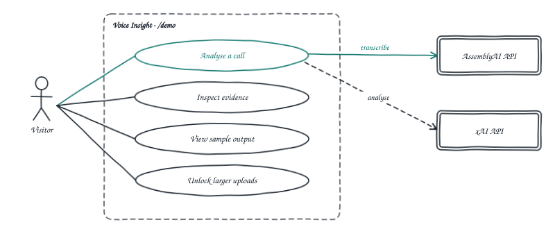

*Fig. 1: Use case diagram: a visitor analyses a call, inspects the evidence, views a free sample, or unlocks larger uploads.*

| ID | Use case | Behaviour |
|---|---|---|
| UC1 | Analyse a call | Checks the file size against the visitor's limit, relays the audio to AssemblyAI, polls until the transcript is ready, then returns a score, category scores, strengths and coaching points, each with a verified quote, plus measured metrics. About 50 s for a 10-minute call. |
| UC2 | Inspect evidence | Clicking a quote, a timeline bar or a transcript line seeks the audio to that moment. The Provenance panel lists every dropped claim and its reason. |
| UC3 | View sample output | Shows a built-in example result, including one discarded claim, under a banner. No API is called. |
| UC4 | Unlock larger uploads | In public mode, a valid access code sets a signed cookie that lifts the upload cap from `PUBLIC_MAX_MB` to 4.5 MB. In private mode, the code is required to open `/demo` at all. |

## 3. Architecture

There is one runtime part: a Next.js 16 app. Its browser side holds the audio file (played from an object URL), the job id and the result. Its server side is three stateless API routes plus an optional access gate in `proxy.ts`. Two third-party APIs do the heavy work: AssemblyAI for speech-to-text and xAI for the LLM. There is no database, storage bucket, queue or webhook.

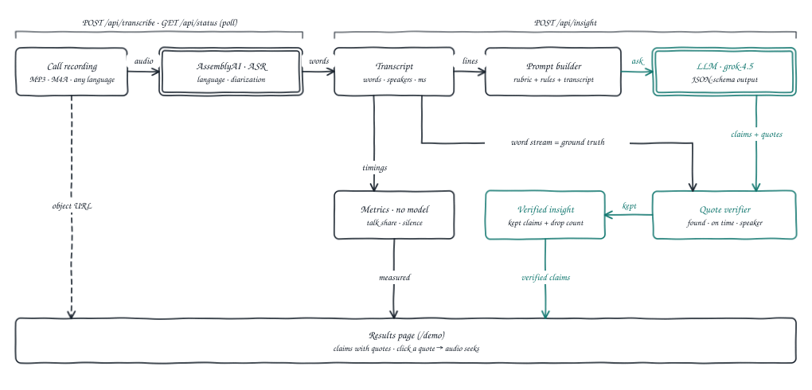

*Fig. 2: Pipeline: audio is transcribed, the LLM judges the transcript, and the verifier checks every quote against the words before anything is shown.*

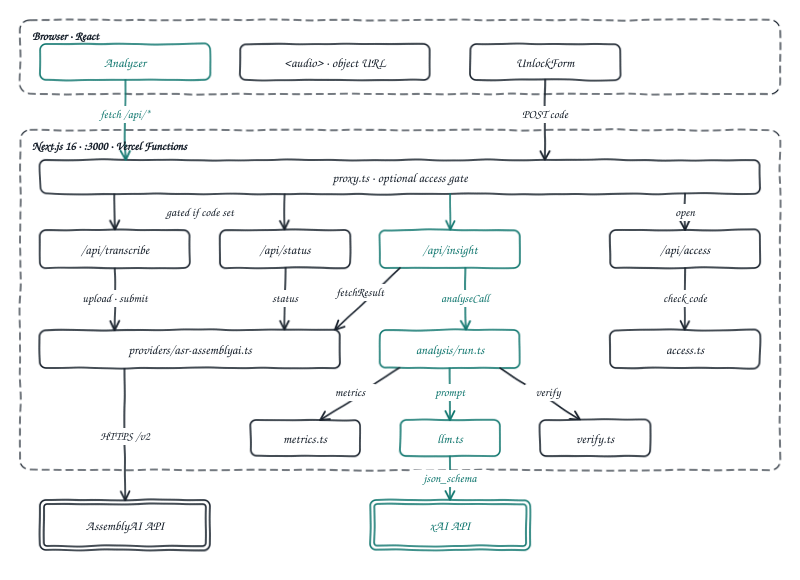

*Fig. 3: Component diagram: the browser, the API routes behind proxy.ts, the analysis modules, and the LLM path to xAI.*

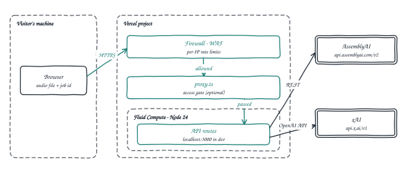

*Fig. 4: Deployment view for the hosted demo on Vercel, with firewall rate limits in front of the access gate.*

## 4. Key flows

### 4.1 Transcription: upload → relay → poll

The browser posts the raw bytes. The route checks the size against the visitor's limit, relays the audio to AssemblyAI's upload endpoint, and starts a job with `language_detection`, `speaker_labels` and `sentiment_analysis`. The browser keeps the job id and polls every 3 s, so the server stays stateless.

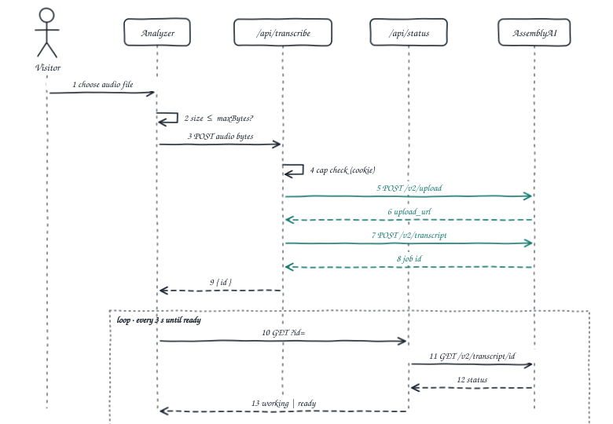

*Fig. 5: Sequence: transcription with polling (CoALA grounding action).*

### 4.2 Analysis: fetch → prompt → infer → verify

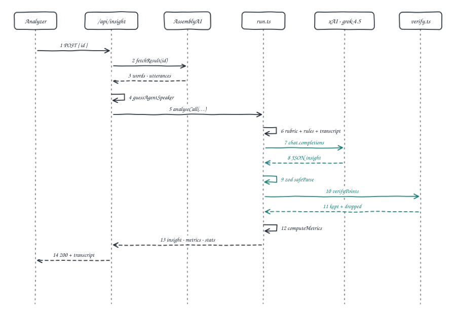

*Fig. 6: Sequence: one analysis (working memory → reasoning → decision procedure).*

### 4.3 Verification: locate → time → speaker

Each quote is fuzzy-matched against the word stream (normalised Levenshtein similarity ≥ `0.85`), then the nearest occurrence must be within `TIMESTAMP_TOLERANCE_MS = 5000` of the claimed time, then the diarized speaker must match. A kept quote is snapped to the transcript's own timings. If claims were made and none survived, the overall and category scores are withheld.

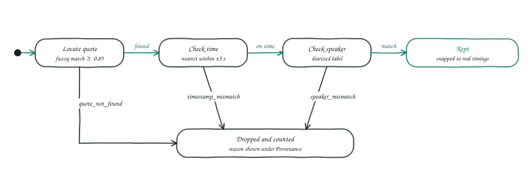

*Fig. 7: State diagram: one model quote through the verifier (CoALA decision procedure).*

### 4.4 Analyzer lifecycle

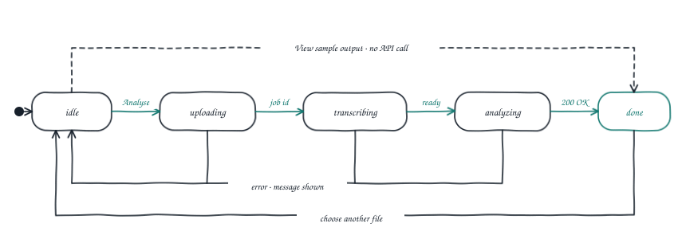

*Fig. 8: State diagram for the Analyzer panel.*

## 5. Backend design

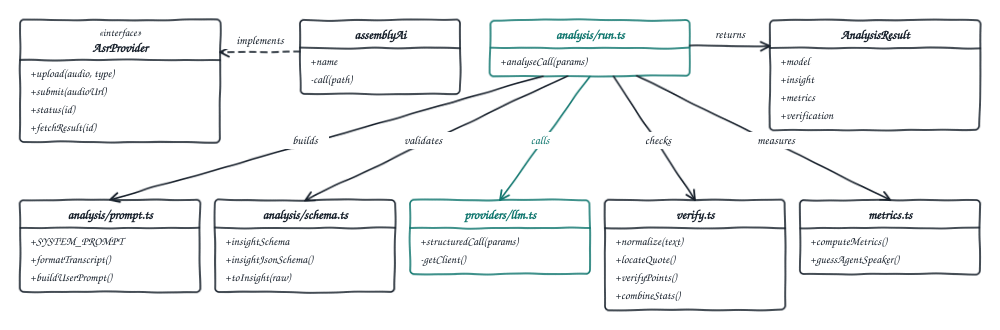

*Fig. 9: Class diagram: analysis modules, the ASR interface and the result model.*

| File | Responsibility |
|---|---|
| `src/app/api/transcribe/route.ts` | Reads the body, enforces `uploadLimitFor(cookie)`, uploads to AssemblyAI and submits the job. `maxDuration = 60`. |
| `src/app/api/status/route.ts` | Returns `working`, `ready` or `failed` for a job id. |
| `src/app/api/insight/route.ts` | Fetches the finished transcript, guesses the agent speaker, runs `analyseCall`. `maxDuration = 300`. |
| `src/app/api/access/route.ts` | `POST` exchanges the code for an HMAC cookie (7 days); `DELETE` clears it. |
| `src/proxy.ts` | Redirects or returns `401` for `/demo` and the three API routes when the gate is active. |
| `src/lib/access.ts` | Gate state, public mode (`PUBLIC_MAX_MB`), per-visitor upload limit, HMAC tokens, constant-time compare, open-redirect guard. |
| `src/lib/providers/asr.ts` · `asr-assemblyai.ts` | The `AsrProvider` interface and its AssemblyAI implementation, normalised to words, utterances, language and sentiment. |
| `src/lib/providers/llm.ts` | `structuredCall()`: OpenAI SDK against `XAI_BASE_URL` (default `https://api.x.ai/v1`), `temperature: 0`, `response_format: json_schema` with `strict: true`. |
| `src/lib/quality-guide.ts` | The nine rubric categories; drives the prompt, the schema enum and the chart. |
| `src/lib/analysis/prompt.ts` | `SYSTEM_PROMPT`, `formatTranscript()` (`[start-end] A [agent]: text`) and `buildUserPrompt()`. |
| `src/lib/analysis/schema.ts` | zod schema for the model's answer, converted to JSON Schema; `toInsight()` maps it to app types. |
| `src/lib/analysis/run.ts` | Orchestrates prompt → model → parse → verify → metrics, and withholds scores when nothing is verified. |
| `src/lib/verify.ts` | Script-aware normalisation, quote location, time and speaker checks, drop reasons and stats. |
| `src/lib/metrics.ts` | Deterministic call metrics and the first-speaker heuristic. |

### System prompt

```text
You are a quality analyst reviewing a recorded customer support call from a contact centre. You produce a short, useful read of the call for the agent's team leader.

You will be given a transcript in its original language. Judge it in that language — do not translate it before reasoning about it, because politeness registers and code-switching are part of what you are assessing.

Rules you must follow exactly:

1. EVIDENCE. Every strength and every coaching point must quote the transcript verbatim, in the original language and script, copied character-for-character from the text you were given. Never paraphrase, translate, tidy, or reconstruct a quote. If you cannot find a real quote for a point, drop the point.

2. TIMESTAMPS. Copy start_ms and end_ms from the utterance the quote came from. Do not estimate them.

3. SCORE EVERY CATEGORY OR ABSTAIN. Return one entry per category key. Where the call gave no opportunity to judge one — the topic never arose, the customer hung up first — set its score to null rather than a low number. A null costs the agent nothing; a guessed 40 is a false accusation. Tag every strength and coaching point with the category it belongs to.

4. SAY LESS RATHER THAN GUESS. Returning one strength and one coaching point is better than padding to three. An empty list is acceptable. A short call may warrant a null score — say so in score_basis rather than inventing a number.

5. NO INVENTION. Do not infer facts absent from the transcript: not the customer's identity, not company policy, not what happened after the call, not the agent's intent. If the transcript is ambiguous, say so.

6. BE SPECIFIC. "Showed empathy" is useless to a team leader. "Acknowledged the delay in her own words before offering the fix" is useful. Coaching points should name what to do differently next time.

7. ENGLISH PROSE. Write summary, points and score_basis in English whatever the call's language, so one reviewer can read every call.

Your quotes will be checked automatically against the transcript. Any point whose quote cannot be located will be discarded.
```

The user prompt adds the detected language, the duration, the rubric categories and the transcript in its original language, one `[start_ms-end_ms]` line per utterance.

### API contract

| Method | Path | Request | Response |
|---|---|---|---|
| `POST` | `/api/transcribe` | raw audio body, `content-type` audio/* | `{"id"}` |
| `GET` | `/api/status?id=` | n/a | `{"state":"working"}` · `{"state":"ready"}` · `{"state":"failed","error"}` |
| `POST` | `/api/insight` | `{"id"}` | `{"transcript":{"utterances","words","sentimentSegments","languageCode","languageConfidence","durationMs","agentSpeakerLabel"},"model","insight","metrics","verification"}` |
| `POST` | `/api/access` | `{"code"}` | `{"ok":true}` + `Set-Cookie: voice_insight_access` |
| `DELETE` | `/api/access` | n/a | `{"ok":true}`, cookie cleared |

Errors: `400` for an empty body, a missing `id` or invalid JSON; `401` for a missing access cookie on a gated route or a wrong code; `409` when posting a code to a deployment with no `ACCESS_CODE`; `413` for a file over the visitor's limit; `422` when no speech was detected; `500` with a readable `error` for provider or schema-validation failures.

## 6. Data model

Nothing is persisted, so there is no schema to migrate. The shapes live in TypeScript (`src/lib/analysis/types.ts`, `src/lib/providers/asr.ts`), and the model's half is enforced by the zod schema in `src/lib/analysis/schema.ts`. One `/api/insight` response is the whole record, and it lives only in the browser tab.

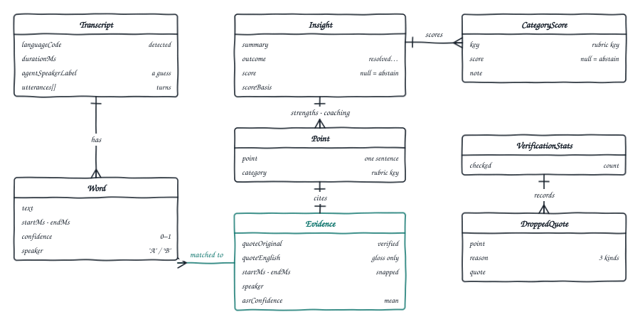

*Fig. 10: Entity-relationship diagram of the /api/insight response.*

## 7. Frontend design

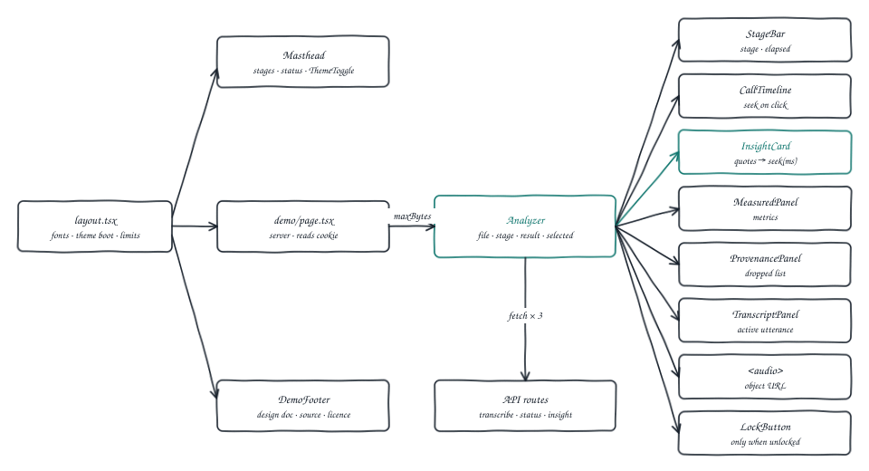

*Fig. 11: Frontend component tree: the shared masthead and footer around the Analyzer, which owns all state.*

- The root layout wraps every page in the shared demo look (newsroom tool, from the demo-doc skill): a masthead strip linking The Inference Times and this post, the pipeline as a stage strip, a status note with the public upload limit, a night-edition toggle, and a footer linking the design doc, source, fork and licence.
- `demo/page.tsx` is a server component: it reads the access cookie and passes `maxBytes`, `gated` and `canUnlock` to the client `Analyzer`, which owns all state.
- The Analyzer calls the three routes with plain `fetch`, polling `/api/status` every 3 s, and shows a stage bar with elapsed time.
- One `seek(ms)` function moves the `<audio>` element. Quotes, the call timeline and transcript lines all call it, which is what makes the evidence checkable by ear. Measured panels are labelled apart from the model's judgement, and Provenance shows how many quotes were checked and dropped.

## 8. Project layout

```text
voice-insight-template/
├── README.md                       quick start, pipeline figure, deploy + spending limits
├── CONTRIBUTING.md · LICENSE       MIT
├── .env.example                    ASSEMBLYAI_API_KEY, XAI_API_KEY, ACCESS_CODE, PUBLIC_MAX_MB
├── .github/                        CI (lint · typecheck · test · build), issue + PR templates
├── docs/
│   ├── ARCHITECTURE.md             stage-by-stage walkthrough
│   ├── DESIGN.md                   this document
│   └── figures/                    fig-01 … fig-11 (hand-drawn SVG)
└── src/
    ├── proxy.ts                    optional access gate
    ├── app/                        layout · demo-look.css · page · demo/ · unlock/ · api/{transcribe, status, insight, access}
    ├── components/                 analyzer.tsx · charts/ · landing/ · demo-look/ · unlock-form · lock-button
    └── lib/                        access · limits · metrics · verify · quality-guide · analysis/ · providers/
```

## 9. Run & verify

No install needed to try it: the [live demo](https://voice-insight.nitingoswami.io) runs in public mode with a capped upload size, and **View sample output** works without uploading anything. To run it yourself:

```bash
git clone https://github.com/nitingoswami-io/voice-insight-template.git && cd voice-insight-template
npm install
cp .env.example .env.local     # add ASSEMBLYAI_API_KEY and XAI_API_KEY
npm test                       # offline, no keys needed
npm run dev                    # http://localhost:3000
```

| Check | Expected |
|---|---|
| `npm test` | 110 tests pass with no network or keys. |
| `GET /` and `GET /demo` | `200`; with no `ACCESS_CODE`, no lock button is shown. |
| `/demo` → **View sample output** | A scored call with verified quotes, and one claim under Provenance discarded as `quote_not_found` ("Engineer Tuesday morning ko definitely aa jayega, I guarantee it."). |
| Upload a 10-minute support call (mono MP3) | About 50 s end to end; every coaching point carries a quote that plays the right moment when clicked. |
| `PUBLIC_MAX_MB=0.001` and a 4 KB upload | `413` with "The public demo accepts up to …". With a valid access cookie the same upload passes the cap. |
| `ACCESS_CODE` set: `POST /api/transcribe` with no cookie | `401` `{"error":"Access code required."}`; `/demo` redirects to `/unlock?next=%2Fdemo`. |

## 10. Next steps

| Idea | What it teaches |
|---|---|
| Persist analyses and let a reviewer accept or reject each point | **Episodic memory**, and a human-gated **learning action** that tunes the rubric from feedback |
| Stereo (`multichannel`) recordings | Removes the speaker-role guess and turn-boundary errors |
| A "swap speakers" control | Small UI fix with a visible effect on every score |
| Direct-to-storage uploads with signed URLs | Lifts the 4.5 MB cap; how serverless body limits shape architecture |
| A second `AsrProvider` (self-hosted Whisper) and a vLLM endpoint | Provider seams; keeping transcripts on your own infrastructure |
| Aggregate the drop rate across many calls | Verification stats as a live hallucination metric |

### Contribute

Fork the repo, pick an idea from the table, and open a pull request. Bugs and unclear steps go in [issues](https://github.com/nitingoswami-io/voice-insight-template/issues/new); the workflow is in [CONTRIBUTING.md](../CONTRIBUTING.md). [Fork](https://github.com/nitingoswami-io/voice-insight-template/fork)

## Credits & sources

1. Theodore R. Sumers, Shunyu Yao, Karthik Narasimhan, Thomas L. Griffiths. [*Cognitive Architectures for Language Agents*](https://arxiv.org/abs/2309.02427) (2023). The CoALA vocabulary (grounding and reasoning actions, working and procedural memory, the decision procedure) used to map each stage.
2. AssemblyAI. [*Speaker Diarization*](https://www.assemblyai.com/docs/speaker-diarization). The `speaker_labels` feature that splits agent and customer.
3. xAI. [*Structured Outputs*](https://docs.x.ai/docs/guides/structured-outputs). `response_format` with `json_schema`, which makes a quote mandatory on every observation.
4. Colin McDonnell and contributors. [*zod*](https://github.com/colinhacks/zod). Schema definition and validation for the model's answer (MIT).
5. V. I. Levenshtein. *Binary codes capable of correcting deletions, insertions, and reversals* (1966). The edit distance behind fuzzy quote matching.
6. Vercel. [*create-next-app*](https://nextjs.org/docs/app/api-reference/cli/create-next-app). The starting scaffold.
7. Original work. The quote-verification layer (text, time and speaker checks with counted drops and withheld scores), the measured-versus-judged split, and the public-demo cost limits are new in this design.

---

voice-insight-template · design document · source of truth: `docs/DESIGN.md` in the repository.
