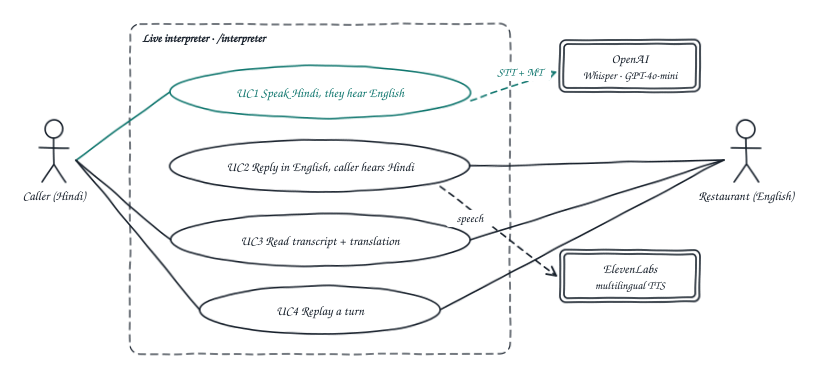
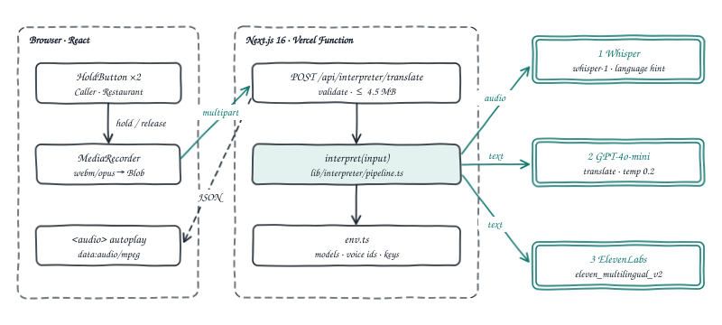
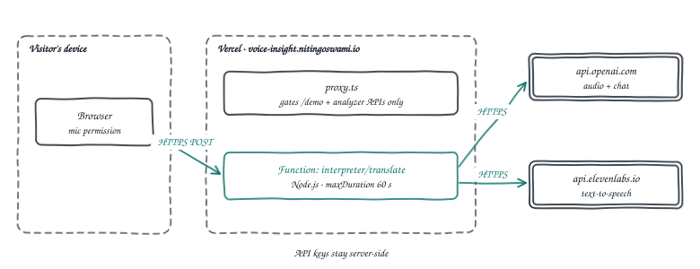
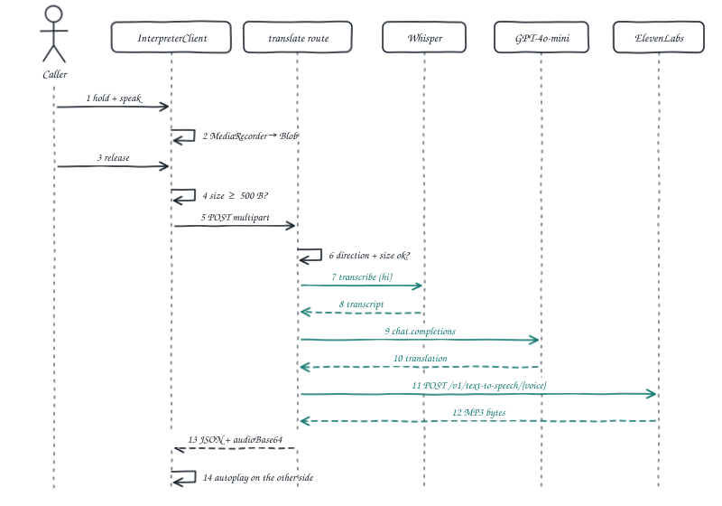
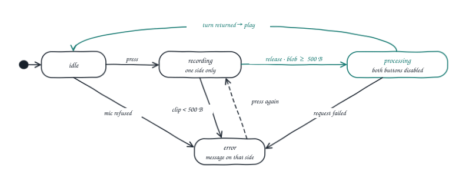
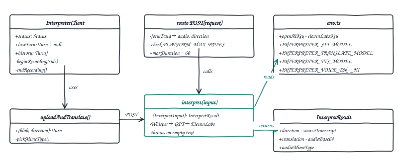
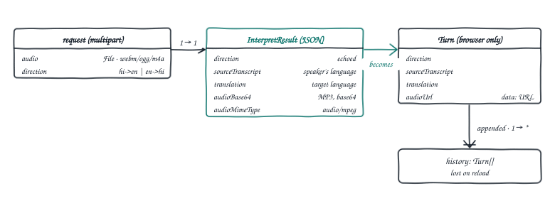
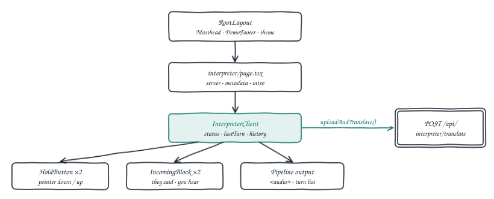

# Voice Interpreter: speak Hindi, the other side hears English

`DESIGN DOCUMENT · voice-interpreter`

*A live, two-way Hindi↔English voice interpreter in one batch request per turn: OpenAI Whisper hears it, GPT-4o-mini translates it, ElevenLabs speaks it. Every intermediate is on the page, and each stage maps to the CoALA framework.*

| Stack | Models | Date | Status |
|---|---|---|---|
| Next.js 16 · OpenAI API · ElevenLabs API · MediaRecorder · Tailwind CSS 4 | `whisper-1` · `gpt-4o-mini` · `eleven_multilingual_v2` | 15 Nov 2026 | Approved · built |

[Live demo](https://voice-insight.nitingoswami.io/interpreter) · [View code](https://github.com/nitingoswami-io/voice-insight-template) · [Fork](https://github.com/nitingoswami-io/voice-insight-template/fork) · [Report an issue](https://github.com/nitingoswami-io/voice-insight-template/issues/new) · [Contribute](https://github.com/nitingoswami-io/voice-insight-template/blob/main/CONTRIBUTING.md)

---

## 1. Purpose & scope

The app is a learning demo for the cascaded voice interpreter: a native Hindi speaker calls a US restaurant, holds a button, speaks, and the restaurant hears English. The restaurant replies the same way. Each turn is one request through three stages, and the page shows all three outputs: what was heard, what it became, and how it sounds. In CoALA terms (after Sumers et al., 2023), the hold-to-talk button is a human-run **decision procedure** that decides when the agent acts. Speech-to-text is a **grounding action** that perceives the turn. The interpreter rules in the system prompt are **procedural memory**. The LLM's translation is a **reasoning action**. Speaking the result aloud is a second **grounding action**, this time acting on the world. There is no **episodic memory**: each turn stands alone.

**CoALA pipeline**

| Stage | Key | Does | CoALA role |
|---|---|---|---|
| 1 | `HoldButton` · `MediaRecorder` | Hold to talk · record | Decision procedure (human-gated) |
| 2 | `whisper-1` | Audio → transcript | Grounding action (perception) |
| 3 | `system prompt` | Interpreter rules | Procedural memory |
| 4 | `gpt-4o-mini` | Translate the turn | Reasoning action |
| 5 | `eleven_multilingual_v2` | Text → speech · autoplay | Grounding action (speak) |

### In scope

- Record one utterance per button press in the browser, with a codec fallback (`webm/opus`, `webm`, `ogg/opus`, `mp4`).
- Transcribe it with Whisper, passing the known source language (`hi` or `en`) as a hint.
- Translate it with GPT-4o-mini at `temperature: 0.2`, keeping numbers, names and dish names verbatim.
- Speak the translation with ElevenLabs and autoplay it for the other side.
- Show the source transcript, the translation and the audio for every turn, plus a running history.
- Run independently of the analyzer at `/demo`: it needs only `OPENAI_API_KEY` and `ELEVENLABS_API_KEY`.

### Out of scope

Streaming at any stage, voice activity detection (hands-free turns), barge-in, conversation context across turns, real telephony, persistence, and an access gate on the interpreter route. Section 10 lists these as follow-ups.

## 2. Use cases



*Fig. 1: Use case diagram: the caller and the restaurant each speak and hear the other side; both can read every intermediate and replay a turn.*

| ID | Use case | Behaviour |
|---|---|---|
| UC1 | Speak Hindi, they hear English | On release, posts the clip with `direction=hi->en`, then shows the Hindi transcript and the English translation and autoplays the English MP3. About 3.6 s for a 4-second sentence on the live demo. |
| UC2 | Reply in English, caller hears Hindi | The same hop with `direction=en->hi`; the Hindi audio plays on the caller's side. |
| UC3 | Read transcript and translation | Each side's panel shows "they said" in the source language and "you hear" in the target language. The output panel lists every turn as "heard" and "said". |
| UC4 | Replay a turn | The latest MP3 stays in the `<audio>` element with controls, so a blocked autoplay or a missed sentence can be replayed. |

## 3. Architecture

There is one runtime part: the Next.js 16 app that also hosts the Voice Insight analyzer. Its browser side records audio and holds the turn history. Its server side is a single stateless route, `POST /api/interpreter/translate`, which calls `interpret()` in `src/lib/interpreter/pipeline.ts`. Two third-party APIs do the work: OpenAI for speech-to-text and translation, and ElevenLabs for speech. There is no database, storage, queue, polling or webhook: every stage fits in one function invocation.



*Fig. 2: Component diagram: one POST per turn; interpret() runs Whisper, GPT-4o-mini and ElevenLabs in order and returns all three outputs in one JSON body.*



*Fig. 3: Deployment view on Vercel: the function calls both providers over HTTPS; the proxy.ts gate covers the analyzer but not this route.*

## 4. Key flows

### 4.1 One hop: record → transcribe → translate → speak

The caller holds the button; `MediaRecorder` collects chunks until release. A clip under 500 bytes is rejected in the browser. Otherwise the client posts `audio` and `direction` as multipart form data. The route checks both fields and the 4.5 MB platform cap, then `interpret()` runs the three stages one after another. The MP3 comes back base64-encoded inside the JSON, so the client can drop it into the `<audio>` element as a `data:` URL with no second request.



*Fig. 4: Sequence: one hop (CoALA grounding → reasoning → grounding).*

### 4.2 Panel lifecycle: idle → recording → processing → idle

Only one side can record at a time. While a turn is processing, both buttons are disabled, so the two sides can't talk over each other. That makes turn-taking explicit and keeps the demo simple, at the cost of barge-in.



*Fig. 5: State diagram for the interpreter panel.*

## 5. Backend design



*Fig. 6: Class diagram: client, route, pipeline, configuration and the result model.*

| File | Responsibility |
|---|---|
| `src/app/interpreter/page.tsx` | Server component: page metadata, the restaurant-call introduction and the privacy note. |
| `src/app/interpreter/interpreter-client.tsx` | Client component: hold-to-talk, `MediaRecorder`, codec choice, status, history and autoplay. |
| `src/app/api/interpreter/translate/route.ts` | Parses the multipart form, validates `audio` and `direction`, enforces `PLATFORM_MAX_BYTES`, calls `interpret()`. `maxDuration = 60`. |
| `src/lib/interpreter/pipeline.ts` | `interpret()`: Whisper (`response_format: "json"`, `language` hint), then GPT-4o-mini (`temperature: 0.2`), then the ElevenLabs REST call (`stability: 0.5`, `similarity_boost: 0.75`). Throws on an empty transcript or translation. |
| `src/lib/env.ts` | `openAiKey`, `elevenLabsKey`, and the `INTERPRETER_*` model and voice overrides with their defaults. |
| `src/lib/limits.ts` | `PLATFORM_MAX_BYTES` (4.5 MB), shared with the analyzer. |

### System prompt

The prompt is built from the direction. This is the `hi->en` version; for `en->hi` the two language names swap.

```text
You are a professional Hindi→English interpreter for a restaurant phone call. Translate the user's utterance into natural, spoken English. Return ONLY the translation. No preamble, no quotes, no romanization, no notes. Preserve numbers, names, dish names and brand names verbatim. If the source is already in the target language, repeat it unchanged.
```

The user message is the Whisper transcript, nothing else.

### API contract

| Method | Path | Request | Response |
|---|---|---|---|
| `POST` | `/api/interpreter/translate` | multipart: `audio` (file), `direction` (`hi->en` or `en->hi`) | `{"direction","sourceTranscript","translation","audioBase64","audioMimeType":"audio/mpeg"}` |

Errors: `400` for a body that isn't multipart, a missing or empty `audio`, or an unknown `direction`; `413` for a clip over 4.5 MB; `500` with a readable `error` for "No speech detected", an empty translation, or an ElevenLabs failure (status and the first 200 characters of its reply).

## 6. Data model

Nothing is persisted, so there is no schema. The request and response shapes are TypeScript types in `src/lib/interpreter/pipeline.ts` (`InterpretInput`, `InterpretResult`). The browser maps each result to a `Turn` with a `data:` URL and keeps the list in React state until the page reloads.



*Fig. 7: Entity-relationship diagram of one hop and the in-browser history.*

## 7. Frontend design



*Fig. 8: Frontend component tree: the client component owns all state; only it calls the API.*

- The page uses the shared demo look (newsroom tool, from the demo-doc skill). The masthead links "Analyze a call", "Live interpreter", the design doc and the source.
- `InterpreterClient` renders two panels side by side, the Caller ("हिन्दी बोलने वाला") in `--series-1` and the Restaurant (English) in `--series-2`, each with a hold button and an incoming block.
- The hold button uses pointer events, so it works with a mouse, a finger or a pen. Releasing the button sends the turn.
- Every intermediate is shown on purpose. Whisper's one-step `translations` endpoint would be shorter, but it would hide the transcript, and the transcript is what the demo teaches.

## 8. Project layout

```text
voice-insight-template/
├── .env.example                    adds OPENAI_API_KEY, ELEVENLABS_API_KEY, INTERPRETER_* overrides
├── docs/
│   ├── ARCHITECTURE.md             § 7 compares the interpreter with the analyzer
│   └── interpreter/
│       ├── DESIGN.md               this document
│       └── figures/                fig-01 … fig-08 (hand-drawn SVG)
└── src/
    ├── app/
    │   ├── interpreter/            page.tsx · interpreter-client.tsx
    │   └── api/interpreter/        translate/route.ts
    └── lib/
        ├── interpreter/            pipeline.ts
        └── env.ts · limits.ts      keys, models, voices · 4.5 MB cap
```

## 9. Run & verify

No install needed to try it: the [live interpreter](https://voice-insight.nitingoswami.io/interpreter) is public. Allow the microphone, hold the Caller button and speak Hindi. To run it yourself:

```bash
git clone https://github.com/nitingoswami-io/voice-insight-template.git && cd voice-insight-template
npm install
cp .env.example .env.local     # add OPENAI_API_KEY and ELEVENLABS_API_KEY
npm test                       # offline, no keys needed
npm run dev                    # http://localhost:3000/interpreter
```

| Check | Expected |
|---|---|
| `npm test` | 110 tests pass with no network or keys. None cover the interpreter yet (see section 10). |
| `GET /interpreter` | `200`, with two panels: Caller and Restaurant. |
| `POST` a 4-second Hindi clip, `direction=hi->en` ("नमस्ते, क्या आज रात दो लोगों के लिए टेबल मिल सकती है?", spoken by macOS `say -v Lekha`) | `sourceTranscript` in Devanagari, word for word; `translation` "Hello, is there a table available for two people tonight?"; an MP3 of about 52 KB. 3.6 s end to end on the live demo. In the browser, the English audio autoplays on the Restaurant side. |
| `POST` with `direction=fr->en` | `400` `{"error":"Field 'direction' must be 'hi->en' or 'en->hi'."}` |
| `POST` with no `audio` field | `400` `{"error":"Missing or empty 'audio' file."}` |
| Tap the button without speaking | The panel shows "Too short — hold the button and speak for at least a second." No request is sent. |

## 10. Next steps

| Idea | What it teaches |
|---|---|
| Add `/api/interpreter` to the access gate and a firewall rate limit | Bounding spend on a public demo that calls two metered APIs |
| Keep the last few turns in the translation prompt | **Episodic memory** as working-memory context: "the dish I asked about" resolves |
| Stream each stage (partial transcripts, chunked TTS) | Time to first audio; why streaming changes the contract between stages |
| Voice activity detection instead of hold-to-talk | Endpointing and silence thresholds in a noisy room |
| Barge-in: stop playback when the other side starts talking | Full-duplex turn-taking, the hardest part of real-time voice |
| Unit tests for the route with mocked providers | Testing a pipeline whose stages are all third-party calls |

### Contribute

Fork the repo, pick an idea from the table, and open a pull request. Bugs and unclear steps go in [issues](https://github.com/nitingoswami-io/voice-insight-template/issues/new); the workflow is in [CONTRIBUTING.md](https://github.com/nitingoswami-io/voice-insight-template/blob/main/CONTRIBUTING.md). [Fork](https://github.com/nitingoswami-io/voice-insight-template/fork)

## Credits & sources

1. Alec Radford, Jong Wook Kim, Tao Xu, Greg Brockman, Christine McLeavey, Ilya Sutskever. [*Robust Speech Recognition via Large-Scale Weak Supervision*](https://arxiv.org/abs/2212.04356) (2022). Whisper, the speech-to-text model behind whisper-1 in the recognise step.
2. OpenAI. [*Speech to text*](https://platform.openai.com/docs/guides/speech-to-text). The transcriptions endpoint and its language hint, used for the first stage.
3. ElevenLabs. [*Create speech (text-to-speech API)*](https://elevenlabs.io/docs/api-reference/text-to-speech/convert). The REST call that turns the translation into MP3 bytes, called with one fetch and no SDK.
4. ElevenLabs. [*Models*](https://elevenlabs.io/docs/models). eleven_multilingual_v2, which speaks Hindi and English with the same voice id.
5. MDN Web Docs. [*MediaRecorder*](https://developer.mozilla.org/en-US/docs/Web/API/MediaRecorder). Browser recording for hold-to-talk, including the isTypeSupported codec fallback.
6. Theodore R. Sumers, Shunyu Yao, Karthik Narasimhan, Thomas L. Griffiths. [*Cognitive Architectures for Language Agents*](https://arxiv.org/abs/2309.02427) (2023). The CoALA vocabulary (grounding and reasoning actions, procedural memory, decision procedure) used to map each stage.
7. Vercel. [*create-next-app*](https://nextjs.org/docs/app/api-reference/cli/create-next-app). The starting scaffold, shared with the Voice Insight analyzer.
8. Original work. The visible three-stage cascade (every intermediate shown), the restaurant-call framing and the side-by-side comparison with the Voice Insight analyzer are new in this design.

---

voice-interpreter · design document · source of truth: `docs/interpreter/DESIGN.md` in the repository.
